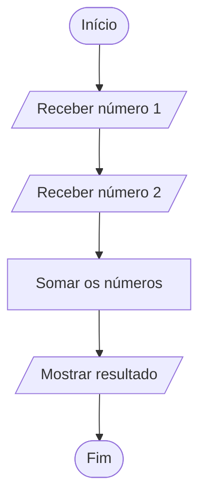
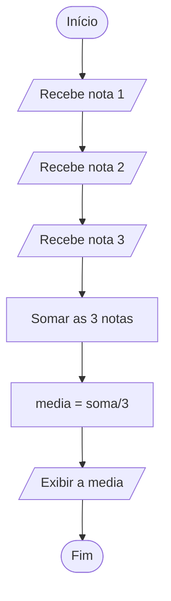

# AULA 12 — FLUXOGRAMAS E REPRESENTAÇÃO VISUAL

## 1. Objetivo da aula

Representar visualmente o funcionamento de algoritmos utilizando fluxogramas.

Aprender a identificar os principais símbolos, compreender o fluxo de execução e transformar algoritmos em representações visuais utilizando Mermaid.

---

# PARTE 1 — TEORIA

## 2. Símbolos principais dos fluxogramas

### 2.1. Início/Fim — Terminal

Representa o início ou o encerramento de um algoritmo.

Formato: oval ou retângulo com bordas arredondadas.

### 2.2. Processo

Representa operações e cálculos realizados pelo algoritmo.

Formato: retângulo.

Exemplos:
- Somar dois números.
- Calcular uma média.
- Multiplicar valores.

### 2.3. Entrada/Saída

Representa o recebimento ou a apresentação de dados.

Formato: paralelogramo.

Exemplos:
- Receber um número.
- Solicitar a idade.
- Mostrar um resultado.

### 2.4. Decisão

Representa a avaliação de uma condição.

Formato: losango.

Exemplos:
- Idade maior ou igual a 18?
- Número maior que zero?
- Senha correta?

### 2.5. Setas

Indicam o fluxo de execução do algoritmo, mostrando a sequência das etapas e a direção que deve ser seguida.

---

## 3. Fluxograma — Somar dois números

### 3.1. Lógica do algoritmo

1. Iniciar.
2. Receber o primeiro número.
3. Receber o segundo número.
4. Somar os dois números.
5. Apresentar o resultado.
6. Finalizar.

### 3.2. Representação do algoritmo

```text
       (Início)
           |
        A, B
           |
       S = A + B
           |
           S
           |
         (Fim)
```

### 3.3. Pseudocódigo

```text
Início
    Leia número1
    Leia número2
    Soma = número1 + número2
    Escreva Soma
Fim
```

---

## 4. Fluxograma — Calcular uma média

### 4.1. Lógica do algoritmo

1. Iniciar.
2. Receber a primeira nota.
3. Receber a segunda nota.
4. Receber a terceira nota.
5. Somar as três notas.
6. Dividir a soma por três.
7. Apresentar a média.
8. Finalizar.

### 4.2. Representação do algoritmo

```text
       (Início)
           |
         A, B, C
           |
      Soma = A + B + C
           |
       M = Soma / 3
           |
           M
           |
         (Fim)
```

### 4.3. Pseudocódigo

```text
Início
    Leia nota1
    Leia nota2
    Leia nota3

    media = (nota1 + nota2 + nota3) / 3

    Escreva media
Fim
```

---

## 5. Fluxograma — Verificar idade (condição)

### 5.1. Lógica do algoritmo

1. Iniciar.
2. Solicitar a idade.
3. Verificar se a idade é maior ou igual a 18.
4. Se sim: apresentar "maior de idade".
5. Se não: apresentar "menor de idade".
6. Finalizar.

### 5.2. Representação da decisão

```text
             (Início)
                 |
               Idade
                 |
           Idade >= 18?
             /       \
          Sim         Não
           |           |
    Maior de idade  Menor de idade
           |           |
           +-----+-----+
                 |
               (Fim)
```

### 5.3. Pseudocódigo

```text
Início
    Leia idade

    Se idade >= 18 Então
        Escreva "maior de idade"
    Senão
        Escreva "menor de idade"
    FimSe

Fim
```

---

# PARTE 2 — EXERCÍCIOS TEÓRICOS

## 6. Perguntas e respostas

### 1. Qual símbolo representa o início?

Resposta: Terminal (oval ou retângulo com bordas arredondadas).

### 2. Qual representa uma decisão?

Resposta: Losango.

### 3. Qual representa processamento?

Resposta: Retângulo.

### 4. Qual representa entrada e saída?

Resposta: Paralelogramo.

### 5. Qual a função das setas?

Resposta: Indicam o fluxo de execução.

### 6. Por que um fluxograma facilita a compreensão de um algoritmo? Por quê?

Resposta:

Representa visualmente, de maneira organizada e sequencial, todas as etapas necessárias para resolver um problema.

---

# PARTE 3 — LABORATÓRIO PRÁTICO

## 7. Utilização do Mermaid

Foi utilizado o Mermaid Live Editor para transformar códigos em diagramas visuais.

Site utilizado:

https://mermaid.live/

O Mermaid permite criar fluxogramas por meio de uma linguagem textual.

### 7.1. Estrutura inicial do código



### Observação

- `flowchart` identifica o tipo de diagrama.
- `TD` significa Top Down, ou seja, de cima para baixo.
- `A`, `B`, `C`, `D`, `E` e `F` identificam os nós.
- `-->` representa a conexão e a direção do fluxo.
- `([Texto])` representa um terminal.
- `[/Texto/]` representa entrada ou saída.
- `[Texto]` representa processamento.

---

## 8. Fluxograma prático — Soma de dois números

### Código Mermaid


### Etapas representadas

1. Início.
2. Receber número 1.
3. Receber número 2.
4. Somar os números.
5. Mostrar resultado.
6. Fim.

### Evidência

Fluxograma construído e visualizado no Mermaid Live Editor.

---

## 9. Fluxograma prático — Média de três notas

### Código Mermaid



### Etapas representadas

1. Início.
2. Receber nota 1.
3. Receber nota 2.
4. Receber nota 3.
5. Somar as três notas.
6. Dividir a soma por três.
7. Exibir a média.
8. Fim.

### Evidência

Fluxograma construído e visualizado no Mermaid Live Editor.

---

# PARTE 4 — ORGANIZAÇÃO E VERIFICAÇÃO NO TERMUX

## 10. Arquivos criados

Foi utilizado o Termux para armazenar os códigos Mermaid em arquivos com extensão `.mmd`.

### 10.1. Listagem dos arquivos

Comando executado:

```bash
ls
```

Resultado:

```text
media_tres_notas.mmd
notas_11.md
soma.mmd
soma.py
```

### 10.2. Verificação do arquivo media_tres_notas.mmd

Comando executado:

```bash
cat media_tres_notas.mmd
```

Conteúdo:

```text
# Mermaid
flowchart TD
    A([Início]) --> B[/Recebe nota 1/]
    B --> C[/Recebe nota 2/]
    C --> D[/Recebe nota 3/]
    D --> E[Somar as 3 notas]
    E --> F[media = soma/3]
    F --> G[/Exibir a media/]
    G --> H([Fim])
```

### 10.3. Verificação do arquivo soma.mmd

Comando executado:

```bash
cat soma.mmd
```

Conteúdo:

```text
# Mermaid
flowchart TD
    A([Início]) --> B[/Receber número 1/]
    B --> C[/Receber número 2/]
    C --> D[Somar os números]
    D --> E[/Mostrar resultado/]
    E --> F([Fim])
```

### Observação técnica

A extensão `.mmd` identifica arquivos que contêm código Mermaid.

O comando `cat` permite visualizar o conteúdo de um arquivo diretamente no terminal.

O Termux permite escrever, editar e armazenar códigos Mermaid, mas não renderiza diretamente os diagramas. Para visualizar os fluxogramas, foi utilizado o Mermaid Live Editor.

---

# PARTE 5 — TECHNICAL ENGLISH

## 11. Vocabulário técnico

| Inglês | Português |
|---|---|
| Flowchart | Fluxograma |
| Decision | Decisão |
| Process | Processo |
| Start | Início |
| End | Fim |
| Arrow | Seta |

### Atividade

Identificar os símbolos de um fluxograma utilizando seus nomes em inglês.

---

# PARTE 6 — OBSERVAÇÕES E NOTAS DE APRENDIZADO

## 12. Diferença entre algoritmo, pseudocódigo e fluxograma

### Algoritmo

É uma sequência lógica e organizada de instruções para resolver um problema.

### Pseudocódigo

Representa o algoritmo por meio de instruções textuais estruturadas, sem depender de uma linguagem de programação específica.

### Fluxograma

Representa visualmente a sequência de instruções e decisões de um algoritmo.

### Relação entre os três

Um mesmo problema pode ser representado de três maneiras:

1. Algoritmo: descreve a lógica da solução.
2. Pseudocódigo: organiza essa lógica em instruções textuais.
3. Fluxograma: apresenta essa lógica visualmente.

## 13. Observações técnicas importantes

- Todo fluxograma deve apresentar início e fim.
- As setas precisam indicar corretamente a sequência de execução.
- O paralelogramo representa entrada e saída de dados.
- O retângulo representa processamento.
- O losango representa uma decisão.
- Uma decisão normalmente apresenta dois caminhos: verdadeiro e falso.
- O operador `>=` significa maior ou igual.
- A média aritmética é calculada somando os valores e dividindo pela quantidade de valores.

## 14. Relação com a programação em Python

Os conceitos estudados nesta aula são utilizados diretamente na programação.

| Fluxograma | Python |
|---|---|
| Entrada de dados | `input()` |
| Processamento | Operações matemáticas |
| Saída de dados | `print()` |
| Decisão | `if` e `else` |
| Sequência | Ordem de execução |

Exemplo:

```python
idade = int(input("Digite sua idade: "))

if idade >= 18:
    print("Maior de idade")
else:
    print("Menor de idade")
```

---

# PARTE 7 — ENTREGA E EVIDÊNCIAS DA AULA

## 15. Entregáveis

- [x] Três fluxogramas elaborados no papel.
- [x] Seis exercícios teóricos resolvidos.
- [x] Código Mermaid para soma de dois números.
- [x] Código Mermaid para média de três notas.
- [x] Fluxograma de soma visualizado no Mermaid Live Editor.
- [x] Fluxograma de média visualizado no Mermaid Live Editor.
- [x] Arquivo `soma.mmd` criado.
- [x] Arquivo `media_tres_notas.mmd` criado.
- [x] Arquivos verificados pelo Termux.
- [x] Atividade de Technical English registrada.

## 16. Evidências produzidas

1. Fotografias das anotações teóricas.
2. Fotografias dos três fluxogramas desenhados à mão.
3. Captura de tela do fluxograma de soma no Mermaid Live Editor.
4. Captura de tela do fluxograma de média no Mermaid Live Editor.
5. Captura de tela da listagem de arquivos no Termux.
6. Captura de tela da verificação dos arquivos `.mmd`.

---

# PARTE 8 — CONCLUSÃO DA AULA

## 17. Aprendizado consolidado

Nesta aula foram estudados os fundamentos da representação visual de algoritmos.

Foi possível compreender os símbolos dos fluxogramas, representar operações matemáticas, construir decisões condicionais e transformar algoritmos em diagramas utilizando Mermaid.

Também foi praticada a utilização do Termux para criar, organizar e verificar arquivos de código Mermaid.

**Principal aprendizado:** um fluxograma permite visualizar a lógica de um algoritmo antes de transformá-lo em código de programação.

